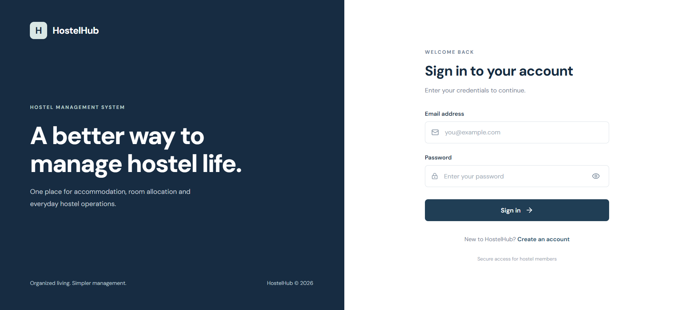
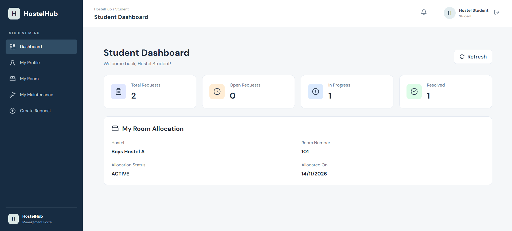
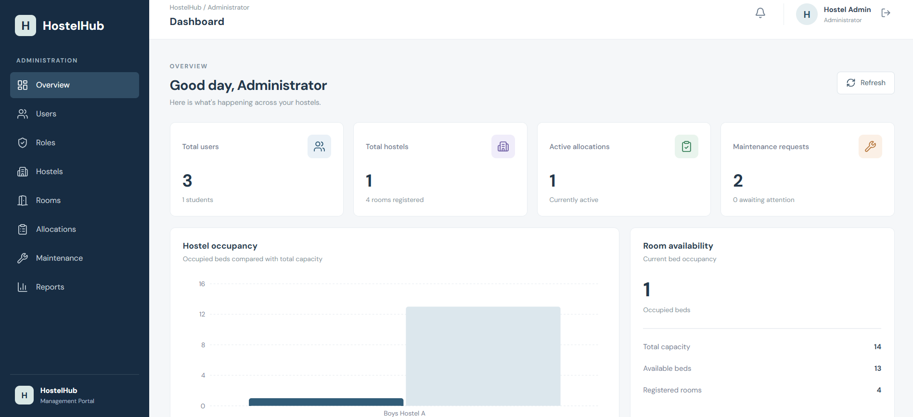
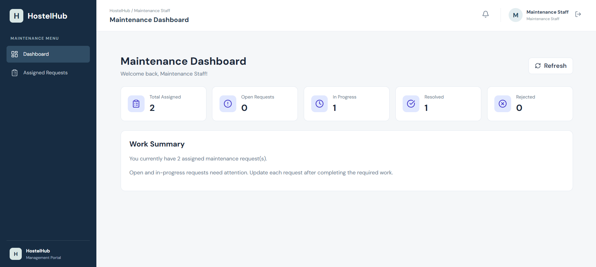
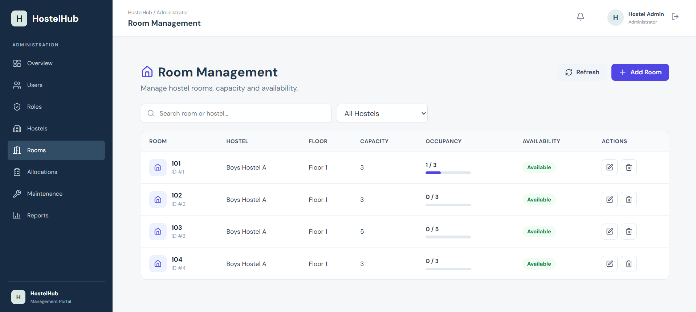

# 🏨 HostelHub — Hostel Management System

A full-stack Hostel Management System designed to simplify and manage hostel operations through a centralized web application.

---

## 📌 Problem Statement

Traditional hostel management involves manual handling of student records, room allocation, maintenance requests, user management, and administrative activities. This can lead to data duplication, delays, difficulty in tracking requests, and inefficient communication.

**HostelHub** provides a centralized digital platform to manage these activities efficiently.

---

## 🎯 Objectives

- Manage student and user information digitally
- Manage hostel rooms and room allocation
- Provide role-based access to different users
- Allow students to submit maintenance requests
- Allow maintenance staff to manage assigned requests
- Provide administrators with management and monitoring features
- Provide secure authentication and authorization
- Centralize hostel-related information in one system

---

## ✨ Key Features

### 👨‍🎓 Student

- Student registration and login
- Student dashboard
- View profile
- View allocated room
- Create maintenance requests
- View maintenance request status
- Track submitted requests

### 🔧 Maintenance Staff

- Maintenance dashboard
- View assigned maintenance requests
- View request details
- Update maintenance request status
- Manage assigned maintenance work

### 👨‍💼 Administrator

- Admin dashboard
- User management
- Role management
- Hostel management
- Room management
- Room allocation management
- Maintenance request monitoring
- Reports and administrative operations

---

## 👥 User Roles

The system provides role-based access for:

- **Admin**
- **Student**
- **Maintenance Staff**

Each role receives access to the functionality relevant to its responsibilities.

---

## 🧩 System Architecture

HostelHub follows a client-server architecture.

```text
                    ┌─────────────────────┐
                    │        User         │
                    │  Browser / Frontend │
                    └──────────┬──────────┘
                               │
                               │ HTTP / REST API
                               ▼
                    ┌─────────────────────┐
                    │     Spring Boot     │
                    │       Backend       │
                    ├─────────────────────┤
                    │ Controllers         │
                    │ Services            │
                    │ Repositories        │
                    │ Entities            │
                    │ Security            │
                    └──────────┬──────────┘
                               │
                               │ JPA / Hibernate
                               ▼
                    ┌─────────────────────┐
                    │      Database       │
                    └─────────────────────┘
```

---

## 🛠️ Technology Stack

### Frontend

- React.js
- JavaScript
- HTML
- CSS
- Vite

### Backend

- Java
- Spring Boot
- Spring Data JPA
- Spring Security
- RESTful APIs
- Maven

### Database

- Relational Database
- JPA / Hibernate

### Development Tools

- IntelliJ IDEA
- Visual Studio Code
- Git
- GitHub

---

## 🔐 Authentication & Authorization

HostelHub implements authentication and role-based authorization.

Users are authenticated before accessing protected functionality, while role-based access controls which pages and operations are available to each user.

Protected frontend routes are implemented to restrict access according to user roles.

---

## 📂 Project Structure

```text
HostelHub/
│
├── backend/
│   ├── src/
│   └── pom.xml
│
├── frontend/
│   ├── src/
│   ├── package.json
│   └── vite.config.js
│
├── .gitignore
└── README.md
```

---

## 🚀 How to Run

### Backend

Navigate to the backend directory:

```bash
cd backend
```

Run the Spring Boot application using Maven:

```bash
mvn spring-boot:run
```

### Frontend

Navigate to the frontend directory:

```bash
cd frontend
```

Install dependencies:

```bash
npm install
```

Start the development server:

```bash
npm run dev
```

The frontend can then be accessed through the local URL provided by Vite.

---

## 📸 Interface Snapshots

### 🔐 Login



### 👨‍🎓 Student Dashboard



### 👨‍💼 Admin Dashboard



### 🔧 Maintenance Dashboard



### 🏠 Room Management


---

## 🔄 Main Modules

- Authentication
- User Management
- Role Management
- Hostel Management
- Room Management
- Room Allocation
- Student Management
- Maintenance Management
- Dashboard
- Reports

---

## 🔮 Future Scope

- Online hostel fee/payment integration
- Email and SMS notifications
- Advanced reporting and analytics
- Mobile application
- Automated room allocation
- Digital complaint notifications
- Cloud deployment
- Improved monitoring and analytics

---

## 📜 License

This project is developed for academic and educational purposes.

---

## 👨‍💻 Project

**HostelHub — Hostel Management System**

A full-stack web application for efficient digital management of hostel operations.